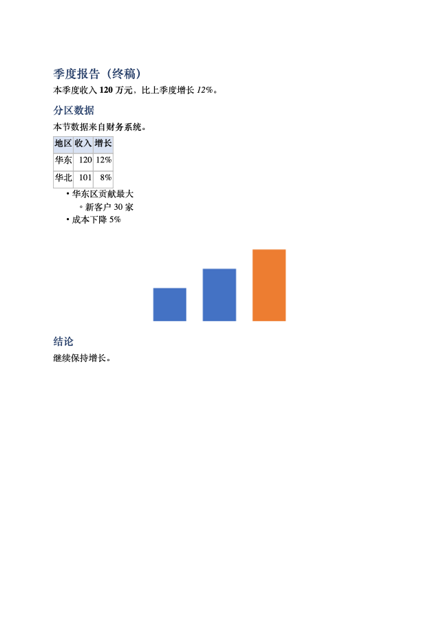
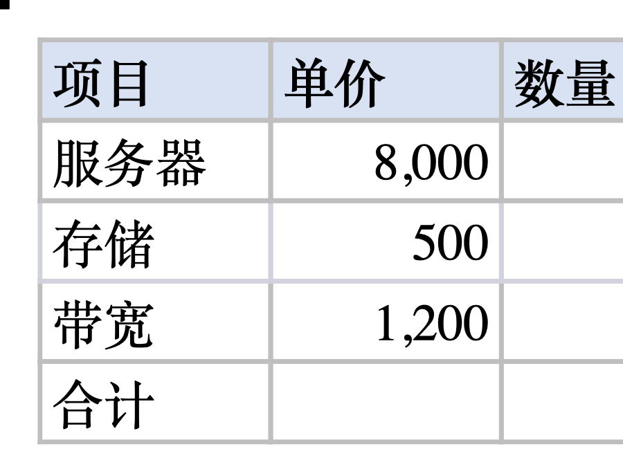
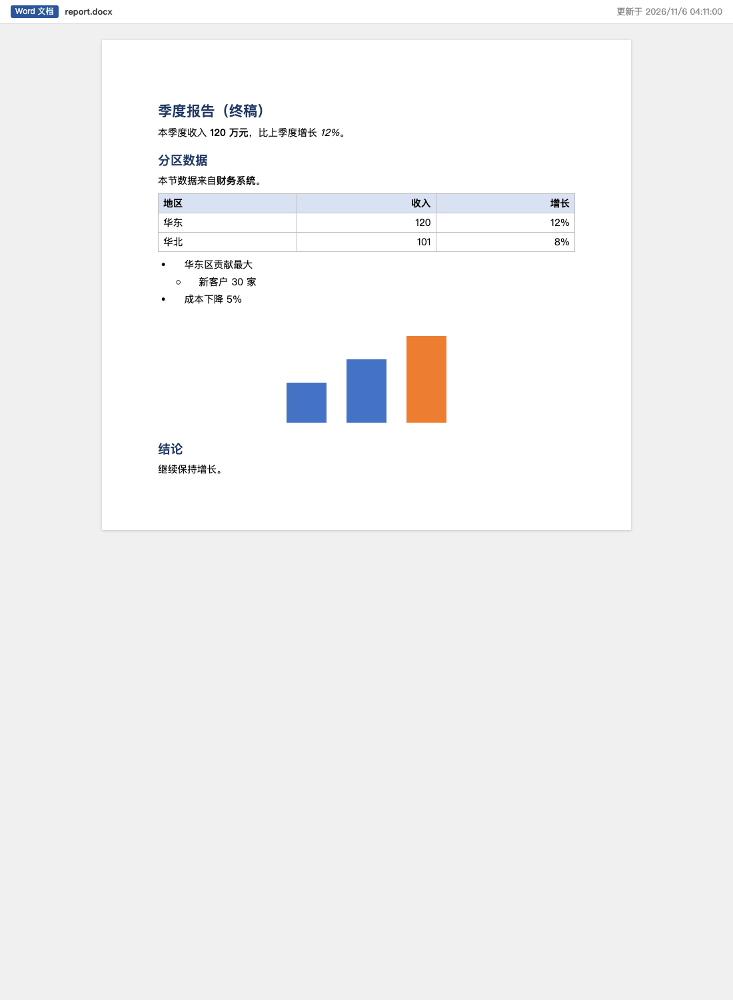

# quire 端到端报告

2026-11-06 04:12:49 PST · darwin/arm64

结果：106 步，失败 0。

## 原版 dsh

| | 步骤 | 详情 |
| --- | --- | --- |
| ✅ | 装进真实 dsh：sdk 模板 profile + quire 包，--dump-config 通过 | dsh 0.2.1-rc.5 |
| ✅ | 准备工作区：图表图片、一个文本文件、一份别的程序（textutil）写的 .docx、一份带别人修订的 .docx、一份带 SmartArt 和组合的 .pptx | legacy.docx 3700 字节 |
| ✅ | 一个回合：假模型依次调用 quire 工具 | 模型收到 29 个工具结果 |
| ✅ | 模型看到八个 quire 工具，系统提示里有 Office 文件的用法 | docx_create、docx_edit、office_preview、office_read、pptx_create、pptx_edit、xlsx_create、xlsx_edit |
| ✅ | docx_create：Markdown 新建 Word 文档（标题、粗斜体、表格、嵌套列表、图片、引用） | Created /private/tmp/quire-e2e-HochaG/ws/report.docx (9 blocks, 6945 bytes). |
| ✅ | office_read（Word）：块编号、标题级别、粗体、表格、列表缩进、图片 | /private/tmp/quire-e2e-HochaG/ws/report.docx<br>Word document: 8 paragraphs, 1 tables, 1 images.<br>Refs [p…] and [t…] name blocks for docx_edit.<br><br>[p1] # 季度报告（草稿）<br>[p2] 本季度收入 **120 万元**，比上季度增长 *12%*。<br>[p3] ## 分区数据<br>[t1] table 3 rows × 3 columns<br>\| 地区 \| 收入 \| 增长 \|<br>\| --- \| --- \| --- \|<br>\| 华东 \| 120 \| 12% \|<br>\| 华北 \| 9… |
| ✅ | docx_edit：替换、改单元格、在块后插入、删除块、追加，一次调用 | Edited /private/tmp/quire-e2e-HochaG/ws/report.docx: replaced 1×; set t1 row 3 col 2; inserted 1 block(s) after p3; deleted 1 block(s); appended 2 block(s). |
| ✅ | office_read：编辑都落在对的位置（插入在 p3 之后、表格之前，引用已删） | /private/tmp/quire-e2e-HochaG/ws/report.docx<br>Word document: 10 paragraphs, 1 tables, 1 images.<br>Refs [p…] and [t…] name blocks for docx_edit.<br><br>[p1] # 季度报告（终稿）<br>[p2] 本季度收入 **120 万元**，比上季度增长 *12%*。<br>[p3] ## 分区数据<br>[p4] 本节数据来自**财务系统**。<br>[t1] table 3 rows × 3 columns<br>\| 地区 \| 收入 \| 增长 \|<br>\| --- \| --- \| --- \|<br>\| 华东 … |
| ✅ | docx_create 不覆盖已有文件：报错并提示用 docx_edit 或 overwrite | Error: "/tmp/quire-e2e-HochaG/ws/report.docx" already exists; read it with office_read and change it with docx_edit, or pass overwrite: true to replace it |
| ✅ | xlsx_create：两张工作表、表头、公式、跨表引用 | Created /private/tmp/quire-e2e-HochaG/ws/budget.xlsx (2 sheet(s), 4377 bytes). |
| ✅ | xlsx_edit：改单元格、设数字格式、加工作表、改名 | Edited /private/tmp/quire-e2e-HochaG/ws/budget.xlsx: set 预算!C2; styled 预算!B2:D4; added sheet 备注; renamed 预算 to 明细. |
| ✅ | office_read（Excel）：重算后汇总 = 8000×5 + 1200×12 = 54400，改名后公式跟着改 | /private/tmp/quire-e2e-HochaG/ws/budget.xlsx<br>Excel workbook: 3 sheets<br>- 明细: A1:D4 (4 rows × 4 columns), frozen at A2<br>- 汇总: A1:B2 (2 rows × 2 columns)<br>- 备注: A1:A2 (2 rows × 1 columns)<br><br>Sheet "汇总", A1:B2:<br>\| \| A \| B \|<br>\| --- \| --- \| --- \|<br>\| 1 \| 总预算 \| =明细!D4 → 54400 \|<br>\| 2 \| 平均单价 \| =AVERAGE(明细!B2:B3) → 46… |
| ✅ | pptx_create：标题页、要点页（两级）、表格页、图片页、备注、主题色 | Created /private/tmp/quire-e2e-HochaG/ws/deck.pptx (4 slide(s), 19809 bytes). |
| ✅ | pptx_edit：替换、改形状文字、备注、移页、删页、加页 | Edited /private/tmp/quire-e2e-HochaG/ws/deck.pptx: replaced 1×; set text of s2.2; set notes of slide 1; moved slide 4 to 2; deleted slide 3; added a slide. |
| ✅ | office_read（PowerPoint）：页序、改过的文字、备注都对，删掉的页不在 | /private/tmp/quire-e2e-HochaG/ws/deck.pptx<br>PowerPoint presentation: 4 slides, 33.9×19.1 cm. Refs [sN.k] name shapes for pptx_edit set_text.<br>Layouts: Title Slide, Title and Content, Section Header, Two Content, Title Only, Blank<br><br>## Slide 1 · Title Slide<br>[s1.1] ctrTitle: 季度经营回顾<br>[s1.2] subTitle: 战略部<br>n… |
| ✅ | docx_edit 别的程序写的文档：替换一处文字 | Edited /private/tmp/quire-e2e-HochaG/ws/legacy.docx: replaced 1×. |
| ✅ | office_read 读回：改了的地方变了，其余内容都在 | /private/tmp/quire-e2e-HochaG/ws/legacy.docx<br>Word document: 9 paragraphs, 0 tables, 0 images.<br>Refs [p…] and [t…] name blocks for docx_edit.<br><br>[p1] **旧文档**<br>[p2] 第一段，由别的程序写的。<br>[p3] 第二段已改好。<br>[p4] 	•	条目一<br>[p5] 	•	条目二<br>[p6] 甲<br>[p7] 乙<br>[p8] 丙<br>[p9] 丁 |
| ✅ | office_preview（原版 dsh）：预览写成 HTML 文件 | Wrote the preview of /private/tmp/quire-e2e-HochaG/ws/report.docx to /var/folders/gn/wvr5dzpd4hs7hl3v5gh9mcj00000gn/T/quire/report.docx-20cf869511f9.html; open it in a browser. |
| ✅ | 沙箱 workspace-write：工作区外的路径拒绝写入 | Error: [sandbox: file access denied under workspace-write mode] "/tmp/quire-e2e-HochaG/ws/../outside.xlsx" is outside the workspace /tmp/quire-e2e-HochaG/ws |
| ✅ | 工作区外没有留下文件 |  |
| ✅ | office_read 非 Office 文件：明确报错 | Error: "notes.txt" is not a Word, Excel or PowerPoint file (.docx, .xlsx or .pptx) |
| ✅ | docx_edit 编号不存在：报错并提示重新 office_read | Error: edit delete: there is no block p99; call office_read for the current refs |
| ✅ | 失败的编辑不动文件 |  |
| ✅ | xlsx_edit：插入一行、写入、按区域加图表（数据标签、图例、轴标题），再改成条形图 | Edited /private/tmp/quire-e2e-HochaG/ws/budget.xlsx: inserted 明细 row 3; wrote 1 row(s) at 明细!A3; added chart 1 on 明细 from A1:B4; edited chart 1 on 明细. |
| ✅ | office_read（Excel）：插入行后下面的公式跟着下移、合计范围扩大；图表和外观设置都列出来 | /private/tmp/quire-e2e-HochaG/ws/budget.xlsx<br>Excel workbook: 3 sheets<br>- 明细: A1:D5 (5 rows × 4 columns), frozen at A2<br>  - chart 1: bar "单价对比" at F2:M16; series 单价; labels value, legend none, y_title "元", y_min 0, no gridlines<br>- 汇总: A1:B2 (2 rows × 2 columns)<br>- 备注: A1:A2 (2 rows × 1 columns)<br><br>Sheet "明… |
| ✅ | office_read：别的表引用插入行下方的单元格，也跟着改 | /private/tmp/quire-e2e-HochaG/ws/budget.xlsx<br>Excel workbook: 3 sheets<br>- 明细: A1:D5 (5 rows × 4 columns), frozen at A2<br>  - chart 1: bar "单价对比" at F2:M16; series 单价; labels value, legend none, y_title "元", y_min 0, no gridlines<br>- 汇总: A1:B2 (2 rows × 2 columns)<br>- 备注: A1:A2 (2 rows × 1 columns)<br><br>Sheet "汇… |
| ✅ | docx_edit：在一段里的「120 万元」上加批注 | Edited /private/tmp/quire-e2e-HochaG/ws/report.docx: added comment 0 on p2. |
| ✅ | docx_edit：回复批注并标为已解决 | Edited /private/tmp/quire-e2e-HochaG/ws/report.docx: replied to comment 0; resolved comment 0. |
| ✅ | office_read（Word）：批注、作者、锚定文字、回复和解决状态都列出来，正文不变 | /private/tmp/quire-e2e-HochaG/ws/report.docx<br>Word document: 10 paragraphs, 1 tables, 1 images; 2 comments.<br>Refs [p…] and [t…] name blocks for docx_edit.<br><br>[p1] # 季度报告（终稿）<br>[p2] 本季度收入 **120 万元**，比上季度增长 *12%*。<br>[p3] ## 分区数据<br>[p4] 本节数据来自**财务系统**。<br>[t1] table 3 rows × 3 columns<br>\| 地区 \| 收入 \| 增长 \|<br>\| --- \| --- \|… |
| ✅ | office_read（Word）：别人的修订按作者、段落、增删列出 | /private/tmp/quire-e2e-HochaG/ws/review.docx<br>Word document: 3 paragraphs, 0 tables, 0 images; 4 tracked changes (the text shows them accepted); track changes is on.<br>Refs [p…] and [t…] name blocks for docx_edit.<br><br>[p1] # 合同草稿<br>[p2] 付款期限为六十天。<br>[p3] 违约金按日万分之三计算。<br><br>Tracked changes (docx_edit accept or rejec… |
| ✅ | docx_edit：接受 p2 的修订，拒绝其余的，关掉修订 | Edited /private/tmp/quire-e2e-HochaG/ws/review.docx: accepted the changes in p2; rejected every change; track changes off. |
| ✅ | office_read 读回：接受的留下、拒绝的复原，文档里不再有修订 | /private/tmp/quire-e2e-HochaG/ws/review.docx<br>Word document: 3 paragraphs, 0 tables, 0 images.<br>Refs [p…] and [t…] name blocks for docx_edit.<br><br>[p1] # 合同草稿<br>[p2] 付款期限为六十天。<br>[p3] 违约金按日万分之五计算。 |
| ✅ | office_read（PowerPoint）：SmartArt 按节点层级列出，组合里的文本框也列出来 | /private/tmp/quire-e2e-HochaG/ws/flow.pptx<br>PowerPoint presentation: 3 slides, 33.9×19.1 cm. Refs [sN.k] name shapes for pptx_edit set_text.<br>Layouts: Title Slide, Title and Content, Section Header, Two Content, Title Only, Blank<br><br>## Slide 1 · Title Only<br>[s1.1] title: 项目流程<br>[s1.2] SmartArt "流程图" (set_t… |
| ✅ | pptx_edit：改 SmartArt 的子节点、顶层节点和组合里的文本框 | Edited /private/tmp/quire-e2e-HochaG/ws/flow.pptx: set text of s1.2.4; set text of s1.2.1; set text of s3.3. |
| ✅ | office_read 读回：SmartArt 节点和组合文字都改了，层级不变 | /private/tmp/quire-e2e-HochaG/ws/flow.pptx<br>PowerPoint presentation: 3 slides, 33.9×19.1 cm. Refs [sN.k] name shapes for pptx_edit set_text.<br>Layouts: Title Slide, Title and Content, Section Header, Two Content, Title Only, Blank<br><br>## Slide 1 · Title Only<br>[s1.1] title: 项目流程<br>[s1.2] SmartArt "流程图" (set_t… |
| ✅ | SmartArt 的数据模型和 PowerPoint 存下的绘图都改了，子节点仍是缩进一级的段落 | data1.xml 与 drawing1.xml 都已更新 |
| ✅ | unzip -t：所有文件都是完整的 zip | report.docx、budget.xlsx、deck.pptx、review.docx、flow.pptx、legacy.docx |
| ✅ | textutil（Apple 的 Word 读取器）读 report.docx：内容与编辑一致 | 季度报告（终稿） 本季度收入 120 万元，比上季度增长 12%。 分区数据 本节数据来自财务系统。 地区 收入 增长 华东 120 12% 华北 101 8% • 华东区贡献最大 • 新客户 30 家 • 成本下降 5% 结论 继续保持增长。 |
| ✅ | 保真：别的程序写的 .docx 改一处文字后，只有 word/document.xml 变了，其余部件逐字节相同 | 变化的部件：[word/document.xml] |
| ✅ | textutil 读 legacy.docx：改动生效，列表与表格都在 | 旧文档 第一段，由别的程序写的。 第二段已改好。 • 条目一 • 条目二 甲 乙 丙 丁 |
| ✅ | Quick Look（macOS 的 Office 渲染器）给四个文件各出一张缩略图 | vanilla-ql-report.docx.png、vanilla-ql-budget.xlsx.png、vanilla-ql-deck.pptx.png、vanilla-ql-flow.pptx.png |
| ✅ | 预览 HTML：内容是改后的文档，图片内联，没有脚本，带 CSP | report.docx-20cf869511f9.html |
| ✅ | Chrome 打开预览页截图 | vanilla-preview-report.png |

本机 python3 没有 python-docx/openpyxl，跳过这一项核对。






预览页截图：



### 模型收到的工具结果

1. `docx_create`（is_error=false）

```
Created /private/tmp/quire-e2e-HochaG/ws/report.docx (9 blocks, 6945 bytes).
```

2. `office_read`（is_error=false）

```
/private/tmp/quire-e2e-HochaG/ws/report.docx
Word document: 8 paragraphs, 1 tables, 1 images.
Refs [p…] and [t…] name blocks for docx_edit.

[p1] # 季度报告（草稿）
[p2] 本季度收入 **120 万元**，比上季度增长 *12%*。
[p3] ## 分区数据
[t1] table 3 rows × 3 columns
| 地区 | 收入 | 增长 |
| --- | --- | --- |
| 华东 | 120 | 12% |
| 华北 | 98 | 8% |
[p4] - 华东区贡献最大
[p5]   - 新客户 30 家
[p6] - 成本下降 5%
[p7] [image: 趋势图 8.5×4.8 cm]
[p8] {Quote} 数据截至 2026-09-30。
```

3. `docx_edit`（is_error=false）

```
Edited /private/tmp/quire-e2e-HochaG/ws/report.docx: replaced 1×; set t1 row 3 col 2; inserted 1 block(s) after p3; deleted 1 block(s); appended 2 block(s).
```

4. `office_read`（is_error=false）

```
/private/tmp/quire-e2e-HochaG/ws/report.docx
Word document: 10 paragraphs, 1 tables, 1 images.
Refs [p…] and [t…] name blocks for docx_edit.

[p1] # 季度报告（终稿）
[p2] 本季度收入 **120 万元**，比上季度增长 *12%*。
[p3] ## 分区数据
[p4] 本节数据来自**财务系统**。
[t1] table 3 rows × 3 columns
| 地区 | 收入 | 增长 |
| --- | --- | --- |
| 华东 | 120 | 12% |
| 华北 | 101 | 8% |
[p5] - 华东区贡献最大
[p6]   - 新客户 30 家
[p7] - 成本下降 5%
[p8] [image: 趋势图 8.5×4.8 cm]
[p9] ## 结论
[p10] 继续保持增长。
```

5. `docx_create`（is_error=true）

```
Error: "/tmp/quire-e2e-HochaG/ws/report.docx" already exists; read it with office_read and change it with docx_edit, or pass overwrite: true to replace it
```

6. `xlsx_create`（is_error=false）

```
Created /private/tmp/quire-e2e-HochaG/ws/budget.xlsx (2 sheet(s), 4377 bytes).
```

7. `xlsx_edit`（is_error=false）

```
Edited /private/tmp/quire-e2e-HochaG/ws/budget.xlsx: set 预算!C2; styled 预算!B2:D4; added sheet 备注; renamed 预算 to 明细.
```

8. `office_read`（is_error=false）

```
/private/tmp/quire-e2e-HochaG/ws/budget.xlsx
Excel workbook: 3 sheets
- 明细: A1:D4 (4 rows × 4 columns), frozen at A2
- 汇总: A1:B2 (2 rows × 2 columns)
- 备注: A1:A2 (2 rows × 1 columns)

Sheet "汇总", A1:B2:
| | A | B |
| --- | --- | --- |
| 1 | 总预算 | =明细!D4 → 54400 |
| 2 | 平均单价 | =AVERAGE(明细!B2:B3) → 4600 |
```

9. `pptx_create`（is_error=false）

```
Created /private/tmp/quire-e2e-HochaG/ws/deck.pptx (4 slide(s), 19809 bytes).
```

10. `pptx_edit`（is_error=false）

```
Edited /private/tmp/quire-e2e-HochaG/ws/deck.pptx: replaced 1×; set text of s2.2; set notes of slide 1; moved slide 4 to 2; deleted slide 3; added a slide.
```

11. `office_read`（is_error=false）

```
/private/tmp/quire-e2e-HochaG/ws/deck.pptx
PowerPoint presentation: 4 slides, 33.9×19.1 cm. Refs [sN.k] name shapes for pptx_edit set_text.
Layouts: Title Slide, Title and Content, Section Header, Two Content, Title Only, Blank

## Slide 1 · Title Slide
[s1.1] ctrTitle: 季度经营回顾
[s1.2] subTitle: 战略部
notes: 开场白

## Slide 2 · Title and Content
[s2.1] title: 趋势
[s2.2] picture "chart.png"

## Slide 3 · Title and Content
[s3.1] title: 核心要点
[s3.2] content:
  - 收入增长 13%
    - 华东区贡献最大
  - 成本下降 5%
notes: 强调华东

## Slide 4 · Title Slide
[s4.1] ctrTitle: 谢谢
[s4.2] subTitle: Q&A
```

12. `docx_edit`（is_error=false）

```
Edited /private/tmp/quire-e2e-HochaG/ws/legacy.docx: replaced 1×.
```

13. `office_read`（is_error=false）

```
/private/tmp/quire-e2e-HochaG/ws/legacy.docx
Word document: 9 paragraphs, 0 tables, 0 images.
Refs [p…] and [t…] name blocks for docx_edit.

[p1] **旧文档**
[p2] 第一段，由别的程序写的。
[p3] 第二段已改好。
[p4] 	•	条目一
[p5] 	•	条目二
[p6] 甲
[p7] 乙
[p8] 丙
[p9] 丁
```

14. `office_preview`（is_error=false）

```
Wrote the preview of /private/tmp/quire-e2e-HochaG/ws/report.docx to /var/folders/gn/wvr5dzpd4hs7hl3v5gh9mcj00000gn/T/quire/report.docx-20cf869511f9.html; open it in a browser.
```

15. `xlsx_create`（is_error=true）

```
Error: [sandbox: file access denied under workspace-write mode] "/tmp/quire-e2e-HochaG/ws/../outside.xlsx" is outside the workspace /tmp/quire-e2e-HochaG/ws
```

16. `office_read`（is_error=true）

```
Error: "notes.txt" is not a Word, Excel or PowerPoint file (.docx, .xlsx or .pptx)
```

17. `docx_edit`（is_error=true）

```
Error: edit delete: there is no block p99; call office_read for the current refs
```

18. `xlsx_edit`（is_error=false）

```
Edited /private/tmp/quire-e2e-HochaG/ws/budget.xlsx: inserted 明细 row 3; wrote 1 row(s) at 明细!A3; added chart 1 on 明细 from A1:B4; edited chart 1 on 明细.
```

19. `office_read`（is_error=false）

```
/private/tmp/quire-e2e-HochaG/ws/budget.xlsx
Excel workbook: 3 sheets
- 明细: A1:D5 (5 rows × 4 columns), frozen at A2
  - chart 1: bar "单价对比" at F2:M16; series 单价; labels value, legend none, y_title "元", y_min 0, no gridlines
- 汇总: A1:B2 (2 rows × 2 columns)
- 备注: A1:A2 (2 rows × 1 columns)

Sheet "明细", A1:D5:
| | A | B | C | D |
| --- | --- | --- | --- | --- |
| 1 | 项目 | 单价 | 数量 | 小计 |
| 2 | 服务器 | 8,000 | 5 | =B2*C2 → 40,000 |
| 3 | 存储 | 500 | 4 | =B3*C3 → 2000 |
| 4 | 带宽 | 1,200 | 12 | =B4*C4 → 14,400 |
| 5 | 合计 |  |  | =SUM(D2:D4) → 56,400 |
```

20. `office_read`（is_error=false）

```
/private/tmp/quire-e2e-HochaG/ws/budget.xlsx
Excel workbook: 3 sheets
- 明细: A1:D5 (5 rows × 4 columns), frozen at A2
  - chart 1: bar "单价对比" at F2:M16; series 单价; labels value, legend none, y_title "元", y_min 0, no gridlines
- 汇总: A1:B2 (2 rows × 2 columns)
- 备注: A1:A2 (2 rows × 1 columns)

Sheet "汇总", A1:B2:
| | A | B |
| --- | --- | --- |
| 1 | 总预算 | =明细!D5 → 56400 |
| 2 | 平均单价 | =AVERAGE(明细!B2:B4) → 3233.3333333 |
```

21. `docx_edit`（is_error=false）

```
Edited /private/tmp/quire-e2e-HochaG/ws/report.docx: added comment 0 on p2.
```

22. `docx_edit`（is_error=false）

```
Edited /private/tmp/quire-e2e-HochaG/ws/report.docx: replied to comment 0; resolved comment 0.
```

23. `office_read`（is_error=false）

```
/private/tmp/quire-e2e-HochaG/ws/report.docx
Word document: 10 paragraphs, 1 tables, 1 images; 2 comments.
Refs [p…] and [t…] name blocks for docx_edit.

[p1] # 季度报告（终稿）
[p2] 本季度收入 **120 万元**，比上季度增长 *12%*。
[p3] ## 分区数据
[p4] 本节数据来自**财务系统**。
[t1] table 3 rows × 3 columns
| 地区 | 收入 | 增长 |
| --- | --- | --- |
| 华东 | 120 | 12% |
| 华北 | 101 | 8% |
[p5] - 华东区贡献最大
[p6]   - 新客户 30 家
[p7] - 成本下降 5%
[p8] [image: 趋势图 8.5×4.8 cm]
[p9] ## 结论
[p10] 继续保持增长。

Comments (docx_edit reply, resolve or delete_comment take the number):
- comment 0 by 审阅人 (resolved) on p2 "120 万元": 数字请财务复核
  - comment 1 by Agent: 已复核，无误
```

24. `office_read`（is_error=false）

```
/private/tmp/quire-e2e-HochaG/ws/review.docx
Word document: 3 paragraphs, 0 tables, 0 images; 4 tracked changes (the text shows them accepted); track changes is on.
Refs [p…] and [t…] name blocks for docx_edit.

[p1] # 合同草稿
[p2] 付款期限为六十天。
[p3] 违约金按日万分之三计算。

Tracked changes (docx_edit accept or reject take the number, or a block, or neither for all):
- change 1: deleted by 王芳 in p2 "三"
- change 2: inserted by 王芳 in p2 "六"
- change 3: deleted by 李雷 in p3 "五"
- change 4: inserted by 李雷 in p3 "三"
```

25. `docx_edit`（is_error=false）

```
Edited /private/tmp/quire-e2e-HochaG/ws/review.docx: accepted the changes in p2; rejected every change; track changes off.
```

26. `office_read`（is_error=false）

```
/private/tmp/quire-e2e-HochaG/ws/review.docx
Word document: 3 paragraphs, 0 tables, 0 images.
Refs [p…] and [t…] name blocks for docx_edit.

[p1] # 合同草稿
[p2] 付款期限为六十天。
[p3] 违约金按日万分之五计算。
```

27. `office_read`（is_error=false）

```
/private/tmp/quire-e2e-HochaG/ws/flow.pptx
PowerPoint presentation: 3 slides, 33.9×19.1 cm. Refs [sN.k] name shapes for pptx_edit set_text.
Layouts: Title Slide, Title and Content, Section Header, Two Content, Title Only, Blank

## Slide 1 · Title Only
[s1.1] title: 项目流程
[s1.2] SmartArt "流程图" (set_text takes s1.2.k for node k):
  - [s1.2.1] 需求调研
  - [s1.2.2] 方案设计
  - [s1.2.3] 开发上线
    - [s1.2.4] 灰度发布

## Slide 2 · Title and Content
[s2.1] title: 人员分工
[s2.2] table 3×3 "Table 3"
| 阶段 | 负责人 | 周期 |
| --- | --- | --- |
| 调研 | 王芳 | 2 周 |
| 开发 | 李雷 | 6 周 |

## Slide 3 · Title Only
[s3.1] title: 备注
[s3.2] 文本框 3: 组合里的第一段
[s3.3] 文本框 4: 组合里的第二段
```

28. `pptx_edit`（is_error=false）

```
Edited /private/tmp/quire-e2e-HochaG/ws/flow.pptx: set text of s1.2.4; set text of s1.2.1; set text of s3.3.
```

29. `office_read`（is_error=false）

```
/private/tmp/quire-e2e-HochaG/ws/flow.pptx
PowerPoint presentation: 3 slides, 33.9×19.1 cm. Refs [sN.k] name shapes for pptx_edit set_text.
Layouts: Title Slide, Title and Content, Section Header, Two Content, Title Only, Blank

## Slide 1 · Title Only
[s1.1] title: 项目流程
[s1.2] SmartArt "流程图" (set_text takes s1.2.k for node k):
  - [s1.2.1] 需求评审
  - [s1.2.2] 方案设计
  - [s1.2.3] 开发上线
    - [s1.2.4] 全量发布

## Slide 2 · Title and Content
[s2.1] title: 人员分工
[s2.2] table 3×3 "Table 3"
| 阶段 | 负责人 | 周期 |
| --- | --- | --- |
| 调研 | 王芳 | 2 周 |
| 开发 | 李雷 | 6 周 |

## Slide 3 · Title Only
[s3.1] title: 备注
[s3.2] 文本框 3: 组合里的第一段
[s3.3] 文本框 4: 组合里改过的第二段
```


## dsh web：人在右侧栏直接编辑 Word / Excel / PowerPoint

| | 步骤 | 详情 |
| --- | --- | --- |
| ✅ | 准备：用 quire 写出三个文件，sdk profile 跑一轮建出会话，web 模板 profile 装上本包 |  |
| ✅ | 启动 dsh web（随机端口） |  |
| ✅ | 无头 Chrome |  |
| ✅ | 客户端模块：boot 清单里有 @precinct/quire，apply 已运行（样式已注入） |  |
| ✅ | 在会话的右侧栏打开 预算.xlsx，显示的是 Quire 编辑器 |  |
| ✅ | 表格：A5 输入文字、D5 输入公式，自动保存；文件里有公式和重算后的缓存值 3264 |  |
| ✅ | 表格：选区 ⌘B 加粗写进样式；工具栏撤销把文件恢复到加粗前 |  |
| ✅ | Agent 在外部改了 B2：编辑器自动载入新内容（编辑栏显示 9000） |  |
| ✅ | 表格：输入 =SUM 弹出函数提示，Tab 补全后写成 SUM(D2:D3)，缓存值 59400 |  |
| ✅ | 表格：选中 A1:D3 升序排序，带宽排到第 2 行，公式随行移动 |  |
| ✅ | 表格：拖动填充柄把 G1「第1周」向下填充，得到 第2周、第3周 |  |
| ✅ | 表格：右键菜单「所有框线」给 A1:D4 加上细边框 |  |
| ✅ | 表格：开启筛选，在 A 列筛选面板里去掉「带宽」，第 2 行被隐藏 |  |
| ✅ | 表格：选中 A1:C3 插入柱形图，系列引用 B2:B3、分类 A2:A3，网格上画出图表 |  |
| ✅ | 表格：筛选隐藏的第 2 行（带宽）不画进图表，系列引用不变 |  |
| ✅ | 表格：拖动图表，锚点写进 drawing 的 twoCellAnchor |  |
| ✅ | 表格：右键图表改成折线图 |  |
| ✅ | 表格：右键「图表选项…」打开数据标签、写数值轴标题和最小值、关掉网格线，写进图表部件并画出来 |  |
| ✅ | 表格：选中图表按 Delete 删除，图表部件一并移除 |  |
| ✅ | 文档：段尾打字、回车分段、选中加粗，自动保存；图片原样保留 |  |
| ✅ | 文档：改表格单元格（120 → 130） |  |
| ✅ | 文档：选中段落改字体为黑体、行距 1.5 倍，写进 w:rFonts 和 w:spacing |  |
| ✅ | 文档：⌘F 查找栏显示 1/1，全部替换「华东区」→「华东地区」 |  |
| ✅ | 文档：粘贴一张图片，插在当前段落后并保存进文件 |  |
| ✅ | 文档：在页眉写「内部资料」，工具栏 # 在页脚插入页码 |  |
| ✅ | 文档：页面设置改为横向，纸张变宽 |  |
| ✅ | 文档：选中「本季度收入」新建批注，写进 comments.xml，正文有批注范围和引用 |  |
| ✅ | 文档：回复批注写进 commentsExtended（paraIdParent），再标记为已解决 |  |
| ✅ | 文档：在开头插入目录（TOC 域 + 书签），目录列出「季度报告」「结论」，每项带点线和页码（PAGEREF） |  |
| ✅ | 文档：标题改成「结论与展望」后更新目录，目录项跟着变 |  |
| ✅ | 文档：粘贴网页里复制的 HTML 表格，插成 Word 表格（表头行、单元格内换行） |  |
| ✅ | 演示：双击标题进入编辑，⌘A 全选后改写，Esc 保存 |  |
| ✅ | 演示：拖动副标题，位置写进 a:xfrm |  |
| ✅ | 演示：改备注，切换页面时保存（原有备注没有被清掉） |  |
| ✅ | 演示：用文件自己的版式新建幻灯片，再撤销 |  |
| ✅ | 演示：插入五角星形状，填充改成红色 |  |
| ✅ | 演示：⌘D 复制出一个相同的形状 |  |
| ✅ | 演示：Shift 多选两个星形，组合写进 p:grpSp，再取消组合 |  |
| ✅ | 演示：两个星形加「淡入」动画写进 p:timing（编辑区显示序号），切换效果「推入」写进 p:transition |  |
| ✅ | 通用：撤销下拉按步列出操作，选「撤销 2 步」一次撤掉切换和动画，形状保留 |  |
| ✅ | 演示：幻灯片母版视图里插入文本框，写进 slideMaster1.xml；回到普通视图，幻灯片上也显示 |  |
| ✅ | 通用：状态栏显示「幻灯片 1 / 2」，缩放滑块 + 放大一档（比例与画面一致），点百分比回到适应窗口 |  |
| ✅ | 演示：放映从当前页开始，→ 翻到第 2 页，Esc 退出 |  |
| ✅ | 演示：一个星形加「强调 · 脉冲」、另一个加「退出 · 飞出」，写成 emph / exit 动画（退出结束时隐藏） |  |
| ✅ | 演示：浏览器拦截观众窗口时，改在本窗口全屏显示观众画面，右下角按钮切回演示者视图 |  |
| ✅ | 通用：文件 › 新建 › 空白 Word 文档，写进工作区并在新标签里用 Quire 打开 |  |
| ✅ | SmartArt：双击节点「方案设计」改写，数据模型和 PowerPoint 存的绘图都改了 |  |
| ✅ | SmartArt：在父节点的形状里改子节点那一行，子节点的数据跟着改，绘图里仍缩进一级；没有自带颜色的文字按形状样式（fontRef）显示为白色 |  |
| ✅ | 表格：右键单元格在下方插入行、在右侧插入列，再删掉「周期」列，行列和网格宽度一起写进文件 |  |
| ✅ | 组合：双击组合里的文本框直接改字，组合保持不变 |  |
| ✅ | 大文件：脚本生成、公式不带结果的 2 万行表格打开时算出全部公式，用时 2.7 秒；函数核对页 71 个难点函数与 Excel 的答案一致（71/71） |  |
| ✅ | 大文件：改 F2 后整本重算并写回（3.6 秒），汇总页 SUMIFS 合计与明细累计、SUMPRODUCT 两项核对都为 0 |  |
| ✅ | 大文件：长文档按纸张分成 107 页，打开并排好版用时 1.1 秒 |  |
| ✅ | 大文件：120 页演示文稿打开用时 1.1 秒，缩略图栏翻到最后一页 |  |
| ✅ | 标注：点工具栏的「标注」进入框选，在第 120 页拖框框住文本框后写下问题，弹窗里带上框选区域的截图；回车后聊天框上方只多一个「1 条标注」胶囊，卡片「大演示.pptx · 第 120 页 [s120.2]「原文」：问题」连同截图收在胶囊里，聊天框文字不变；形状描上虚线框、缩略图带圆点 |  |
| ✅ | 文档：导航窗格列出长文档的 161 个标题，点「第 30 章」跳到第 79 页并高亮这一章，折叠后它下面的 3 个小节收起 |  |
| ✅ | 标注：⇧⌘M 进入框选，框住标题和下一段，标注写成首尾两个段落编号 [p814]–[p815]；Esc 关掉不留痕迹 |  |
| ✅ | 标注：在文档里框住「毛利率同比上升」再标注，胶囊里累积到 2 条，第二条带 office_read 的段落编号 [pN] 和这段文字的截图，原文在文档里标出 |  |
| ✅ | 标注：表格里点「标注」拖框，框到的单元格选中并写成 汇总!B3:D5，带上框内的值；取消后不加卡片 |  |
| ✅ | 标注：表格单元格右键「标注问题…」，第三条写明 汇总!N2、显示的值和公式；三个文件的标注都收在聊天框上方的「3 条标注」胶囊里，不占地方 |  |
| ✅ | 标注：从标注菜单移除这个表格的标注，聊天框上方剩下另外两张卡片，表格上的标记随之消失 |  |
| ✅ | 标注卡片：点胶囊展开列表，每条带截图；点 ✎ 改写第一张卡片的说明，回车保存；点第二张卡片的 × 移除它，胶囊变成「1 条标注」 |  |
| ✅ | 发送：在聊天框输入「按标注改一下」回车，卡片和编辑器里的标记随即清空；模型在同一轮收到这句话、附带的标注 "1. 大演示.pptx · 第 120 页 [s120.2]「•渠道结构进一步优化 –线上占比提升到 42% •新产品线贡献三成收入」：要点改成三条，每条带数字" 和 1 张框选截图，删掉的那条没有发出 |  |
