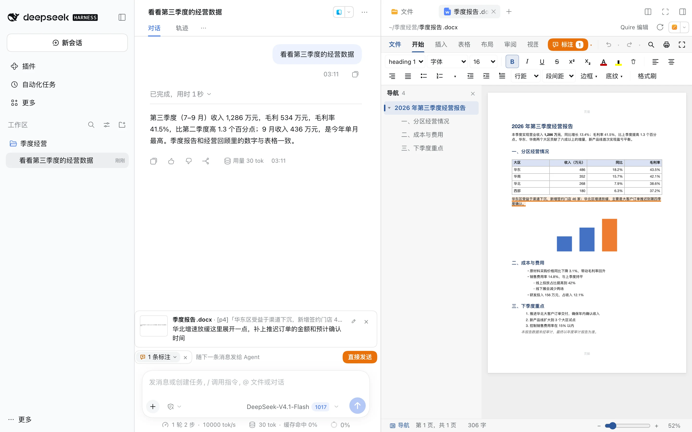

# @precinct/quire

dsh 插件：Agent 读、新建、修改 Word 文档（.docx）、Excel 表格（.xlsx）和 PowerPoint 演示文稿（.pptx），只改要改的地方，其余内容原样保留。纯 JS、零依赖，原版 dsh 装上即可用。

- Agent 工具：`office_read`、`docx_create`、`docx_edit`、`xlsx_create`、`xlsx_edit`、`pptx_create`、`pptx_edit`、`office_preview`。
- `office_preview` 把预览写成 HTML 文件并返回路径。
- dsh web：右侧边栏打开 .docx/.xlsx/.pptx 时换成 Office 式编辑器，人可以直接改；框选文件里的某处写下问题，标注连同截图随下一条消息发给 Agent。

安装：`dsh plugin --profile web add @precinct/quire`，或在 dsh web 侧栏「插件」→「添加插件」输入包名。

源码与测试见 [GitHub 仓库](https://github.com/yiyiSmallti/quire)。
